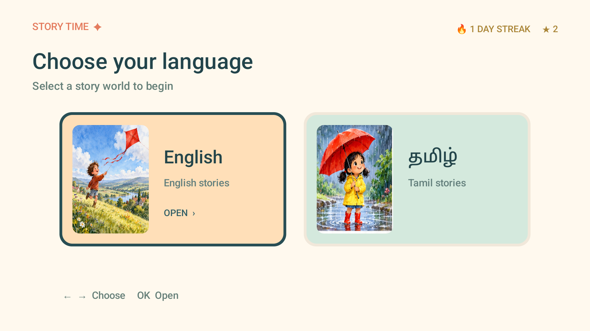
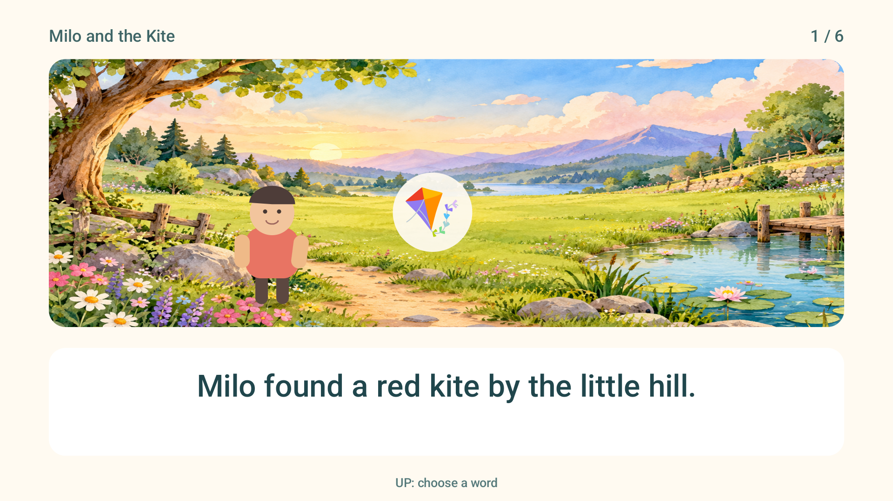

# Story Time TV

A colourful Android TV reading app for children, with English and Tamil stories that can be read offline. Children read at their own pace: the app does not listen to them or assess their reading.





## Features

- 53 English and 25 Tamil short stories, plus two illustrated English picture books.
- Six-page short stories, illustrated covers, animated scene effects and difficulty labels. The story “Milo and the Kite” has six individually illustrated scenes; the other short stories currently use shared illustrated backgrounds.
- D-pad navigation, completion indicators, reading streaks and separate English and Tamil star counts.
- Select a word to hear it spelled; press OK again while spelling to hear its pronunciation. Speech requires a compatible Android text-to-speech voice; offline availability depends on the installed voice.
- Celebrate each completed story with an animated award. Reading progress is stored locally on the device.
- Choose a 1–60 minute countdown before each story. The completion screen shows the percentage of the selected time remaining; it does not assess reading accuracy or understanding.
- Reset all English and Tamil read marks and stars to start the library again; the daily reading streak is preserved. A confirmation screen prevents accidental resets.
- Android TV launcher channel support for the reading streak; launcher support and display vary by device. The streak badge near Ethernet shown in some screenshots requires a compatible custom launcher.

## Remote controls

Choose a language and story using the arrow keys and OK. On a reading page, use **Right** for the next page and **Left** for the previous page. Use **Up** to select a word and **OK** to hear it. **Back** returns to the previous screen. OK does not advance a reading page.

On the story cover, use **Up/Down** to change the timer, then **OK** to start. On a reading page, use **Down** to pause or resume the timer when word selection is closed. The timer also pauses when the app is backgrounded; press Down to resume after returning. Reading navigation is paused until the timer resumes. If time runs out, continue reading and finish normally with a 0% remaining-time score.

To reset the library, press **Up** from the language screen, move left to **Reset**, press **OK**, and choose **Reset stories**. Choose **Cancel** or press **Back** to keep the current progress.

## Build on Windows

Install JDK 17 and the Android SDK platform 35 and build-tools 35.0.0. Set `ANDROID_HOME` or `ANDROID_SDK_ROOT` to the SDK directory, then run:

```powershell
.\build.ps1
adb install -r .\out\story-time-debug.apk
```

The script creates a local debug signing key in `out/`. Debug keys and built APKs are excluded from the repository. This is a development build, not a release-signed APK.

## Content and credits

The included picture books are adaptations of works from Book Dash and Pratham Books / StoryWeaver. See [third-party notices](THIRD_PARTY_NOTICES.md) for attribution, licences and changes. The short stories are sample content and have not had a professional editorial review. Scene effects use shared illustrated backgrounds rather than a unique video for every page.

The code and original content have no licence specified. Third-party material remains subject to its own licence.

## Testing status

The app has been exercised on an Android TV emulator. Real TV hardware, every installed text-to-speech voice, and all device-specific launcher behaviours have not been verified.
